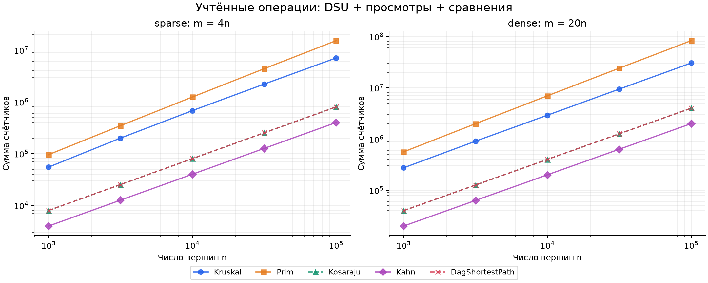
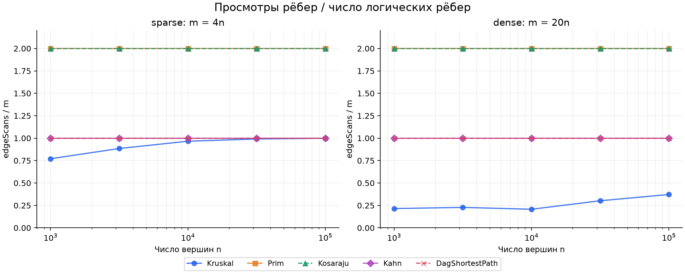
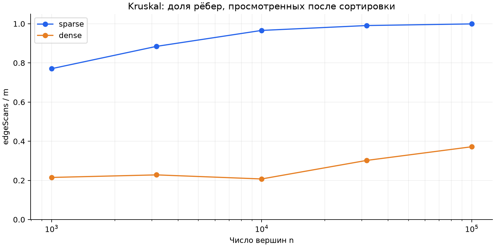

# Assignment 3: графы — отчёт

## 1. Реализация и сложность

Один класс Graph хранит ориентированные и неориентированные мультиграфы списками смежности. Петли, параллельные рёбра, изолированные вершины и пустой граф поддерживаются. MST возвращает лес; Kahn сообщает о цикле, а DAG shortest paths отклоняет циклический вход. Вес ребра — int, суммы — long. Все DFS итеративные.

Обозначения: V — вершины, E — логические рёбра; log E ниже означает log(max(2,E)). Дополнительная память указана сверх входного графа, включая возвращаемый результат.

| Операция | Время | Доп. память | Обоснование |
|---|---|---|---|
| DSU makeSet | O(V) | O(V) | Инициализация parent и size |
| DSU find / union | O(α(V)) амортизированно | O(1) на вызов; DSU хранит O(V) | Сжатие путей и объединение по размеру |
| Kruskal | O(V + E log E) | O(V+E) | Копия и сортировка рёбер, DSU, выбранные рёбра |
| Prim, наша lazy-версия | O(V + E log E) | O(V+E) | Каждое ребро даёт не более одного кандидата, очередь до O(E) |
| Kosaraju | O(V+E) | O(V+E) | Два DFS, транспонированный граф, стеки и массивы |
| Kahn | O(V+E) | O(V) | Каждая вершина входит в очередь один раз, каждое ребро обрабатывается один раз |
| DAG shortest paths | O(V+E) | O(V) | Kahn и один проход релаксаций, distance и parent |

Память исходного графа — O(V+E). Для Prim с одной записью на вершину и decrease-key возможна другая оценка, но эта структура здесь не реализована. На пустом/несвязном графе член O(V) нельзя терять.

### Корректность MST: свойство разреза

Пусть выбранные рёбра A входят в некоторое минимальное остовное дерево T. Возьмём разрез, который не пересекает ни одно ребро A, и самое лёгкое пересекающее его ребро e. Если e уже принадлежит T, его добавление к A безопасно. Иначе добавление e в T создаёт цикл, содержащий другое пересекающее разрез ребро f. Так как w(e)≤w(f), замена f на e сохраняет связность и не увеличивает вес, причём f не принадлежит A. Kruskal применяет этот аргумент к текущим DSU-компонентам, а Prim — к построенной части дерева и оставшимся вершинам. Поэтому оба алгоритма возвращают MST, а для несвязного графа тот же аргумент применяется отдельно к каждой компоненте и даёт минимальный остовный лес.

### Корректность DAG-путей: индукция

Все вершины с нулевой входящей степенью получают расстояние 0, что эквивалентно виртуальному общему источнику. Это база индукции, а остальные расстояния сначала равны бесконечности. Предположим, что для всех вершин перед v в топологическом порядке расстояния уже оптимальны. Любой путь в v заканчивается ребром u→v, где u расположен раньше v. Следовательно, до обработки v все варианты последнего ребра уже релаксированы, и distance[v] равен минимуму их стоимостей. После релаксации исходящих рёбер v инвариант сохраняется, поэтому одного прохода достаточно. Отрицательные веса не нарушают рассуждение: в DAG нет циклов, а каждый предшественник всё равно обработан раньше; parent сохраняет ребро, давшее улучшение.

В общем графе отрицательные рёбра сами по себе допустимы, например для Bellman–Ford; достижимый отрицательный цикл делает расстояния к затронутым вершинам неограниченными снизу.

## 2. Проверки и воспроизводимость

JUnit 5 проверяет DSU против простых меток множеств, MST на 100 случайных связных графах и 40 маленьких графах с полным перебором остовов, SCC против BFS-достижимости в обе стороны на 60 графах до 200 вершин, DAG-пути против Bellman–Ford на 100 DAG с отрицательными весами. Дополнительно проверяются входные файлы, петли, параллельные рёбра, циклы, несколько источников, восстановление пути, переполнение int-сумм и SCC на цепочке из 100 000 вершин. Последняя проверка получает maxDepth=100000 без StackOverflowError.

Генератор создаёт новый Random(42) для каждого графа. Fisher–Yates вызывается перед деревом или DAG; при a=b повторно выбирается **только b**, после допустимой пары генерируется вес. Это уточнение порядка случайных вызовов необходимо для совпадения таблицы. В DAG перемешанный массив используется как rank[vertex], затем концы ориентируются по возрастанию ранга.

Все значения ниже реально вычислены и автоматически сверены с заданием; константы эталона используются только для проверок. Два MST совпали во всех 50 повторных запусках каждого алгоритма (10 графов × 5). Kahn вернул V вершин с проверкой каждого ребра.

| n / m | Вес MST | SCC | Сумма расстояний DAG |
|---|---:|---:|---:|
| 1000 / 4000 | 147970 | 27 | 396274 |
| 1000 / 20000 | 30363 | 1 | 252411 |
| 3162 / 12648 | 468911 | 137 | 1271911 |
| 3162 / 63240 | 97589 | 1 | 723157 |
| 10000 / 40000 | 1486139 | 373 | 3941828 |
| 10000 / 200000 | 309550 | 1 | 2381342 |
| 31623 / 126492 | 4715515 | 1188 | 12551891 |
| 31623 / 632460 | 968517 | 1 | 7376612 |
| 100000 / 400000 | 15012094 | 3923 | 40096539 |
| 100000 / 2000000 | 3056681 | 1 | 23512087 |

Следуем подробному требованию 50 строк CSV; упоминание «четырёх графов» в итоговом списке deliverables противоречит разделу benchmark. Бонусные Tarjan и condensation не входят в эту реализацию.

## 3. Счётчики и формулы

Счётчики увеличиваются внутри операций. dsuOps — число вызовов find плюс число успешных union; find внутри union тоже учитывается. comparisons считает сравнения весов при сортировке/в PriorityQueue и сравнения расстояний при релаксации. maxDepth — наибольшее число элементов явного стека DFS. edgeScans считает проход после сортировки Kruskal, записи смежности Prim, два DFS Kosaraju, обработку очереди Kahn и релаксации DAG.

У Kosaraju построение обратного графа входит в время и полную сложность, но не в 2E просмотров DFS. У DAG-путей время включает Kahn, но счётчик m относится только к релаксациям. Входящие степени поддерживаются при Graph.addEdge, поэтому Kahn копирует массив, не выполняя скрытого первого прохода по рёбрам.

Нормированные значения: от n=1000 до n=100000, через запятую все пять измерений. S — m=4n, D — m=20n.

| Алгоритм и нормировка | S | D |
|---|---|---|
| Kruskal: comparisons / (E log₂ E) | .891, .907, .869, .809, .745 | .903, .846, .784, .720, .666 |
| DSU в Kruskal: dsuOps / E | 2.290, 2.519, 2.682, 2.732, 2.748 | .580, .606, .565, .754, .894 |
| Prim: comparisons / (E log₂ E) | 1.829, 1.865, 1.895, 1.921, 1.934 | 1.825, 1.847, 1.866, 1.878, 1.890 |
| Kosaraju: scans / (V+E) | 1.600 во всех точках | 1.905 во всех точках |
| Kahn: scans / (V+E) | .800 во всех точках | .952 во всех точках |
| DAG: scans / (V+E) | .800 во всех точках | .952 во всех точках |

У обходов отношения строго постоянны, у MST остаются одного порядка, но не обязаны быть одинаковыми. Для Kruskal успешных объединений V−1, а ранняя остановка изменяет число проверенных рёбер: если их k, dsuOps=2k+3(V−1). Этот счётчик не измеряет число переходов по parent и сам по себе не доказывает α(V). Сортировка работает с повторяющимися весами из диапазона 1…1000, поэтому реальные сравнения и их нормировка не обязаны следовать худшему случаю с точным постоянным коэффициентом. Анализ кода обосновывает асимптотику; эксперимент лишь проверяет согласованность на выбранных входах.

Рис. 1. Сумма dsuOps+edgeScans+comparisons, обе оси логарифмические. Это сумма выбранных событий, а не все машинные инструкции. Совпадение линий Kosaraju и DAG объясняется 2m просмотрами у первого и m просмотрами плюс m сравнениями у второго.

## 4. Наклоны, просмотры и время

Наклоны найдены методом наименьших квадратов для log(counter) по log(n), отдельно на пяти точках каждой плотности.

| Счётчик | S: наклон | D: наклон |
|---|---:|---:|
| Kosaraju, Kahn, DAG: edgeScans | 1.0000 | 1.0000 |
| Prim: edgeScans | 1.0000 | 1.0000 |
| Kruskal: edgeScans | 1.0550 | 1.1194 |
| Kruskal: comparisons | 1.0545 | 1.0159 |
| Prim: comparisons | 1.1079 | 1.0903 |

Требование связывает наклон Kruskal edgeScans с E log E, однако сортировку измеряет comparisons. Просмотры после сортировки ограничены E, а их наклон выше 1 на этих точках отражает изменение доли просмотренных рёбер. Даже для E log E log-log наклон на конечном интервале не является универсальной константой. Точные вычисления и дополнительные отношения находятся в [results/analysis.md](results/analysis.md).

Рис. 2. Prim и Kosaraju: 2, Kahn и DAG: 1; соответствующие линии совпадают. У Prim это две записи одного неориентированного ребра, у Kosaraju — два обхода направленного графа.

Рис. 3. Kruskal после сортировки просматривает около 77–100% рёбер в S и 21–37% в D: больше альтернатив позволяет раньше собрать дерево. Сортировать всё равно приходится все рёбра. Lazy Prim сканирует всю смежность и обрабатывает очередь; эти данные объясняют выигрыш Kruskal в данном наборе, но не гарантируют его для любых графов.

**Время.** На локальной машине macOS arm64, JDK 25.0.1, heap до 3 GiB, медианы составили 0.975–255.410 мс для Kruskal, 0.707–1021.307 мс для Prim, 1.132–209.330 мс для Kosaraju, 0.261–38.201 мс для Kahn и 0.573–73.971 мс для DAG-путей. Время измерено по пяти запускам после малого прогрева; генерация и валидация исключены. На малых размерах заметны шум, JIT и сборка мусора. Другая JVM, оборудование и фоновая нагрузка меняют эти значения, поэтому выводы о росте основаны на счётчиках, а не на единичном времени.

## 5. Какой алгоритм выбирать

| Ситуация | Выбор | Причина |
|---|---|---|
| Динамически объединять группы без удаления связей | DSU | Почти постоянная амортизированная стоимость |
| MST, готовый список рёбер, разреженный граф | Kruskal | Простые сортировка и DSU |
| MST, список смежности, удобно расти от вершины | Prim | Сразу рассматривает соседние рёбра; итог зависит от очереди |
| Действительно плотный простой граф E≈V², есть матрица | Матричный Prim O(V²) | Избегает сортировки E рёбер; это отдельная, здесь не реализованная версия |
| Направленный граф, возможны циклы, нужны взаимные зависимости | Kosaraju | Выделяет максимальные сильные компоненты |
| Нужен порядок зависимых задач или обнаружение цикла | Kahn | Даёт порядок только для DAG |
| Кратчайшие пути в DAG, в том числе отрицательные веса | Топологические релаксации | O(V+E), каждый предшественник уже обработан |
| Кратчайшие пути в общем графе | Dijkstra при неотрицательных весах; Bellman–Ford при отрицательных | DAG-метод неприменим без топологического порядка |

Обе серии задания, включая названную dense, имеют E=Θ(V); они не представляют асимптотически плотные графы E=Θ(V²). Git-история содержит 12 последовательных коммитов, тематические feature-ветки и релизный тег v1.0. Команды повторения эксперимента, описание метрик и признание использования AI приведены в README.md.
